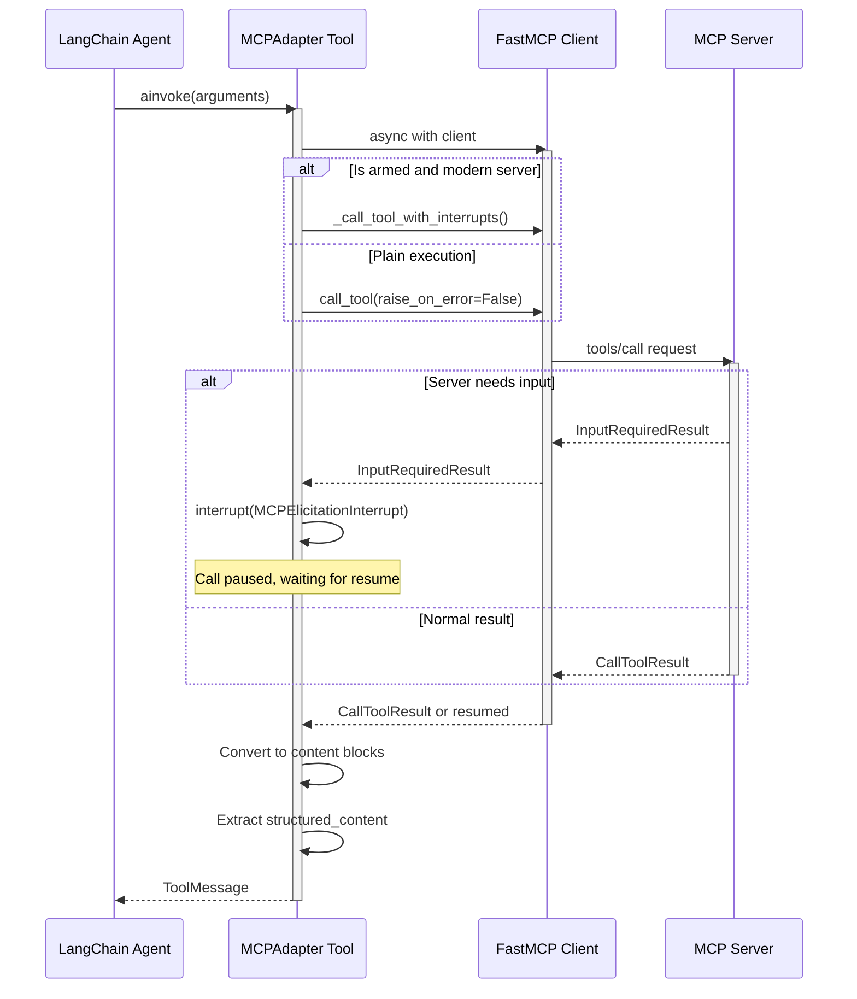
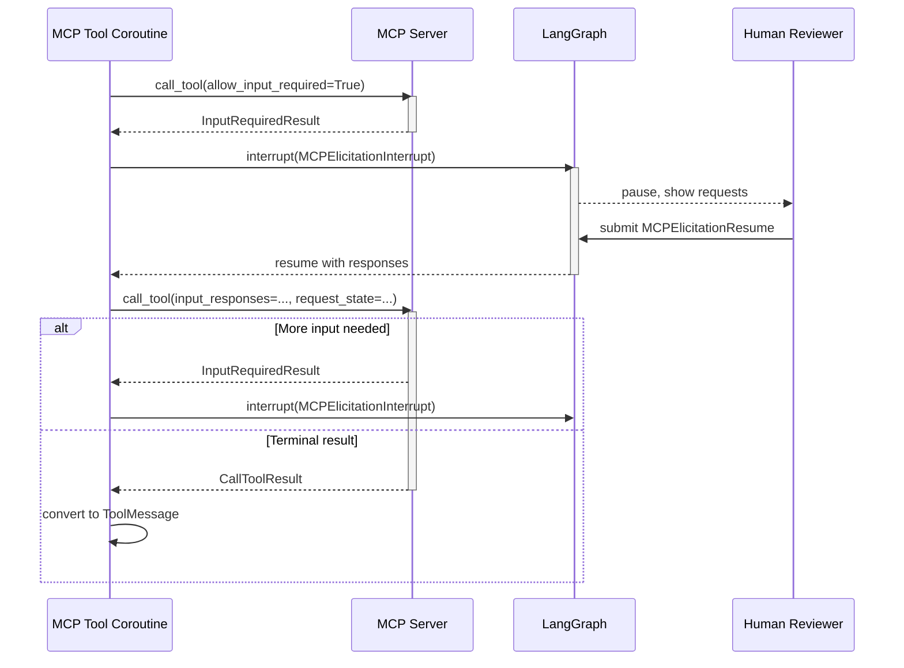

## Overview

The Model Context Protocol (MCP) is a standard specification enabling language model applications to discover and invoke tools exposed by external servers. `langchain.mcp` provides the `MCPAdapter` class, which discovers MCP tools and converts them into LangChain `BaseTool` objects suitable for agents.

The adapter handles:

- **Tool discovery**: Fetches tool definitions from remote MCP servers
- **Protocol negotiation**: Uses FastMCP for client session management and version handshaking
- **Multiple transports**: Supports in-process servers, stdio subprocesses, HTTP streaming, and custom transports
- **Multi-server routing**: Routes calls to correct servers via `ClientGroup` with automatic tool name prefixing
- **Mid-call input handling**: Answers MCP elicitation requests via LangGraph interrupts
- **Error recovery**: Surfaces tool-reported errors to the model for correction and retry

## MCP Protocol Foundations

### Concept and Protocol Roles

MCP defines a request–response protocol with three primary roles:

- **Clients** (LangChain agents) discover available tools and invoke them by name
- **Servers** expose tool catalogs, publish tool input schemas, and execute calls
- **Tools** are named, documented functions with typed arguments returning content blocks
- **Content** is represented as content blocks (text, images, files, structured data) enabling rich result types

### Protocol Versions and Compatibility

MCP has evolved across multiple protocol eras. Modern versions (e.g., 2026-07-28) use `server/discover` for capability advertisement and support `InputRequiredResult` for mid-call elicitation, where the server pauses to request user input before resuming. Legacy servers (e.g., 2025-11-25) use older handshake patterns. Servers from different eras can coexist in one agent when separate adapters are used per server; `MCPAdapter` detects the server's protocol version and selects the appropriate interaction pattern.

## Architecture: MCPAdapter and FastMCP

`MCPAdapter` is the main user-facing entry point. It wraps one or more FastMCP clients and exposes their discovered tools as LangChain tools:

```python
from langchain.agents import create_agent
from langchain.mcp import MCPAdapter

async with MCPAdapter(target) as adapter:
    tools = await adapter.list_tools()
    agent = create_agent("anthropic:claude-sonnet-5", tools)
    result = await agent.ainvoke({"messages": [{"role": "user", "content": "..."}]})
```

### MCP Server Lifecycle: Discovery, Initialization, and Capability Negotiation

The adapter manages the full MCP server lifecycle:

1. **Initialization (`__init__`)**: Constructs a FastMCP client from the target, validates security constraints (e.g., string targets must be HTTP URLs), and arms the client for interrupt-driven elicitation unless a custom handler is already set. For `ClientGroup` targets, each member client is armed independently and cloned to avoid mutating the caller's object.

2. **Connection (`async with` context)**: Entering the context manager calls `__aenter__`, which delegates to the underlying FastMCP client(s) to establish the transport connection (socket for HTTP, subprocess for stdio, in-process attachment for FastMCP instances).

3. **Capability Discovery (`list_tools`)**: Once connected, calls `fastmcp.Client.list_tools()` to fetch tool definitions from the server. This returns `Tool` objects carrying name, description, and input JSON schema. The `cache_mode` parameter controls whether to use cached results (default `"use"`) or refresh from the server (`"refresh"`).

4. **Schema Adaptation (`as_langchain_tool`)**: Each MCP tool is converted to a LangChain `StructuredTool` by reading the tool's input schema, creating an async wrapper that calls the tool through the client, and attaching metadata linking the tool back to its server.

5. **Disconnection (`async with` exit)**: The context exit calls `__aexit__`, releasing the client connection.

### Target Types and Transport Inference

FastMCP infers the transport from the target type. `MCPAdapter` accepts:

- **HTTP/HTTPS URL string**: Reached over streamable HTTP. String validation rejects non-URL strings (e.g., local file paths) to prevent silent local execution when configuration is untrusted.
  ```python
  async with MCPAdapter("https://api.example.com/mcp") as adapter:
      tools = await adapter.list_tools()
  ```

- **`Path`**: Launched as a subprocess over stdio. The script must be executable.
  ```python
  async with MCPAdapter(Path("server.py")) as adapter:
      tools = await adapter.list_tools()
  ```

- **`FastMCP` instance**: In-process server with no network or subprocess overhead. Ideal for tests and embedded deployments.
  ```python
  from fastmcp import FastMCP
  
  server = FastMCP("weather")
  
  @server.tool
  def forecast(city: str) -> str:
      return f"{city}: sunny"
  
  async with MCPAdapter(server) as adapter:
      tools = await adapter.list_tools()
  ```

- **`Client` or `ClientGroup`**: Pre-built FastMCP client(s) allowing custom configuration (authentication, caching, custom transports).
  ```python
  from fastmcp.client import Client
  
  client = Client("https://api.example.com/mcp", auth="bearer-token")
  async with MCPAdapter(client) as adapter:
      tools = await adapter.list_tools()
  ```

- **`MCPConfig` dict**: Multiple servers, each with independent transport and auth. FastMCP connects to all and prefixes tool names by config key to avoid collisions.
  ```python
  config = {
      "mcpServers": {
          "weather": {"command": "python", "args": ["weather_server.py"]},
          "calc": {"url": "https://api.example.com/mcp"},
      }
  }
  async with MCPAdapter(config) as adapter:
      tools = await adapter.list_tools()  # ["weather_forecast", "calc_add", ...]
  ```

- **`ClientTransport`**: Explicit transport (HTTP, stdio, or custom) for fine-grained control and advanced use cases.

## Tool Discovery and Schema Adaptation

### Discovery Pipeline

1. **Connection**: The adapter context enters, establishing the underlying FastMCP client(s).
2. **Fetch**: `client.list_tools(cache_mode=...)` fetches remote tool definitions. The `cache_mode` parameter controls behavior: `"use"` (default) serves cached results if TTL permits, `"refresh"` forces a server call and cache repopulation, `"bypass"` skips the cache entirely.
3. **Conversion**: Each MCP `Tool` is converted by `as_langchain_tool(tool, client)` into a LangChain `StructuredTool`.

### MCP Tool to LangChain Tool Conversion

The conversion pipeline transforms MCP tool definitions into LangChain `StructuredTool` instances:

**Input Schema Normalization**

MCP tool schemas are normalized before use:
- Object-typed properties with no `properties` or constraint keywords (like `additionalProperties`) are marked with `additionalProperties: true` to remain open during provider schema conversion. This ensures that models sending open objects to MCP tools don't have those objects rejected downstream.

**StructuredTool Construction**

Each converted tool is a `StructuredTool` with:

- **name, description**: Copied directly from the MCP tool definition
- **args_schema**: The normalized MCP input JSON schema (as a dict, not a Pydantic model, to avoid rigid validation)
- **coroutine**: An async function that calls the MCP tool through the client, handling both normal and interrupt-driven execution paths
- **response_format="content_and_artifact"**: Returns both model-visible content blocks and structured data in `MCPToolArtifact`
- **metadata["mcp"]**: Carries:
  - `mcp.tool`: Tool-level metadata (annotations, custom `_meta` fields from the server)
  - `mcp.server`: Server identity and capabilities (name, version, capabilities)
- **handle_tool_error=_handle_mcp_tool_error**: Custom handler to surface MCP tool errors to the model for retry

### Multi-Server Tool Prefixing and Routing

When using `ClientGroup` or `MCPConfig`, tool names are prefixed by server key (e.g., `weather_forecast` = `weather` + `forecast`). This prevents collisions and makes tool provenance visible.

The adapter's internal router ensures each call reaches the correct server:

```python
adapter = MCPAdapter(group)
tools = await adapter.list_tools()  # Tool names are prefixed
# e.g., ["weather_forecast", "weather_current_conditions", "calc_add"]

# When a tool is called, the router resolves it to the correct server member
for tool in tools:
    if tool.name == "weather_forecast":
        # Routed to the "weather" client by resolve_tool()
        result = await tool.ainvoke({"city": "Oslo"})
```

## Tool Invocation and Execution

### Async Execution Model

All MCP tools are async (`StructuredTool` with `coroutine`), allowing concurrent tool calls and non-blocking I/O. The tool's coroutine:

1. Accepts keyword arguments matching the tool's input schema
2. Opens the underlying client (FastMCP clients are reentrant, so a connection may already be held)
3. Calls either `_call_tool_with_interrupts()` (if the client is armed for elicitation and server supports `InputRequiredResult`) or `client.call_tool()` with `raise_on_error=False` (plain mode)
4. Converts the result into LangChain content blocks and artifact

### Tool Invocation Flow

The following diagram shows how tool calls flow through the adapter and client:



Tool execution pauses at the adapter boundary to create the content blocks and artifact, so all conversion happens before the coroutine returns.

### Bidirectional Communication: Tool Requests and Results

Tool invocation follows a request–response pattern:

**Request Phase**
```python
# Model generates tool call
tool_call = {
    "name": "weather_forecast",
    "args": {"city": "Oslo"},
    "tool_call_id": "call_abc123"
}

# Agent executes tool
tool = tools[0]
result = await tool.ainvoke(tool_call["args"])
```

**Response Phase**

MCP tools return `CallToolResult` containing:
- **content**: List of content blocks (text, images, files, structured data)
- **structured_content**: Optional structured data in dict form (accessible via artifact)
- **is_error**: Boolean flag indicating success or failure

The adapter converts this into a `ToolMessage`:

```python
# Tool output is converted to LangChain content blocks
# Text content becomes text blocks
# Images become image blocks (base64 or URL)
# Files become file blocks
# Structured content is attached as MCPToolArtifact

ToolMessage(
    content=[{"type": "text", "text": "Oslo: sunny, 20°C"}],
    artifact={"structured_content": {...}},
    tool_call_id="call_abc123",
    status="success" or "error"
)
```

### Content Block Conversion

MCP returns rich content types that are converted to LangChain equivalents:

- **TextContent** → TextContentBlock (plain text)
- **ImageContent** (base64) → ImageContentBlock
- **ResourceLink** (URL) → ImageContentBlock or FileContentBlock depending on MIME type
- **EmbeddedResource** (base64 blob) → ImageContentBlock or FileContentBlock
- **AudioContent** → Not yet supported (raises NotImplementedError)

## Error Handling in MCP Interactions

MCP distinguishes between two error categories:

### Tool-Reported Errors

When a server reports `is_error=true` in `CallToolResult`, the adapter creates a `ToolMessage` with `status="error"` containing the server's error content. This allows the model to see the error and correct itself:

```python
# Server reports an error
result = CallToolResult(
    content=[TextContent(text="Division by zero")],
    is_error=True
)

# Adapter converts to ToolMessage with error status
ToolMessage(
    content=[{"type": "text", "text": "Division by zero"}],
    status="error",
    tool_call_id="call_abc123"
)

# Agent reads the error and retries with valid input
```

The `_handle_mcp_tool_error()` handler reads the error content and formats it for the model. For tool-reported errors only (never transport errors), the model receives the content wrapped in a failed `ToolMessage`.

### Transport and System Errors

Connection failures, schema conversion errors, and other transport issues propagate as Python exceptions rather than being caught by error handling, since a model cannot meaningfully react to them. These are visible to the application for logging and recovery.

## Bidirectional Communication: Mid-Call Input via LangGraph Interrupts

Servers conforming to modern MCP specifications can pause tool execution mid-call to request user input, returning an `InputRequiredResult` containing one or more `InputRequest` objects.

### Elicitation Request Types

MCP supports two elicitation patterns:

1. **Form Elicitation**: Server requests data matching a JSON schema
   ```python
   MCPElicitationFormRequest(
       key="auth_code",
       message="Enter your 2FA code:",
       mode="form",
       requested_schema={"type": "string", "minLength": 6}
   )
   ```

2. **URL Elicitation**: Server requests the user visit a URL (e.g., for OAuth)
   ```python
   MCPElicitationUrlRequest(
       key="oauth_redirect",
       message="Complete authentication at the link below:",
       mode="url",
       url="https://auth.example.com/authorize?client_id=..."
   )
   ```

### Interrupt-Driven Elicitation Flow

When a server returns `InputRequiredResult`:



The loop iterates until the server returns a terminal `CallToolResult` rather than another `InputRequiredResult`.

### Elicitation Validation and Constraints

The interrupt-driven elicitation loop only answers `ElicitRequest` objects (form and URL requests):

- **Sampling requests** (`InputRequest.method == "sample"`) and **roots requests** raise `NotImplementedError` because the model cannot provide samples or root candidates
- **Continuation rounds** (rounds with `request_state` but no `input_requests`) raise `NotImplementedError` because they represent long-running work, not a place to interrupt and ask for input
- **Legacy elicitation** (server-initiated via callback) is not supported; it raises an error guiding the user to a modern server or custom handler

### Adapter Initialization and Elicitation Capability

The adapter automatically arms each client it builds for interrupt-driven elicitation by:

1. Setting an `_elicitation_callback` that advertises the elicitation capability to the server
2. Stamping the client with `_langchain_mcp_interrupt_armed` so downstream tools know to drive the interrupt loop

A pre-built client that already carries a custom `_elicitation_callback` is honored: the adapter leaves it unchanged and the client's own handler answers requests instead. Only clients with no handler are armed, and pre-built clients are cloned before arming to avoid mutating the caller's object.

## Caching and Performance

### Cache Mode and Client Configuration

FastMCP maintains a client-side response cache for tool lists (SEP-2549). The cache reduces latency and server load when the same tools are discovered repeatedly. Configuration happens on the client itself; `MCPAdapter.list_tools()` only selects how discovery reads it:

```python
# Use cached results if available and fresh (default)
tools = await adapter.list_tools(cache_mode="use")

# Force refresh from server
tools = await adapter.list_tools(cache_mode="refresh")

# Skip cache entirely
tools = await adapter.list_tools(cache_mode="bypass")
```

### Cache Partitioning for Multi-User Scenarios

In multi-user deployments, cache should be partitioned per user to prevent information leakage. FastMCP supports per-principal isolation via `CacheConfig`:

```python
import httpx2
from fastmcp import Client
from fastmcp.client.group import ClientGroup
from mcp.client.caching import InMemoryResponseCacheStore, CacheConfig

# Shared cache store (cross-run persistence)
_cache_store = InMemoryResponseCacheStore()

# Shared HTTP transport pool (reuse connections)
_http_pool = httpx2.AsyncHTTPTransport()

async def make_graph(runtime):
    user = runtime.user.identity
    group = ClientGroup({
        name: Client(
            url,
            # Share transport pool across users and runs
            httpx_client_factory=lambda: httpx2.AsyncClient(transport=_http_pool),
            # Partition cache by user; server TTL respects per-user freshness
            cache=CacheConfig(
                store=_cache_store,
                partition=user,
                target_id=user  # For cache invalidation
            ),
        )
        for name, url in SERVERS.items()
    })
    # cache_mode="use" reads the per-user partition
    tools = await MCPAdapter(group).list_tools(cache_mode="use")
```

This pattern allows:
- **Shared transport**: One HTTP connection pool for all users, reducing connection overhead
- **Shared cache**: One cache store with per-user partitions, reducing memory
- **Per-user isolation**: Each user sees only their own cached results
- **Server TTL respect**: Cache freshness is tracked independently per user

### ClientGroup Cache Behavior

Bare `ClientGroup.list_tools()` defaults to `cache_mode="refresh"` to ensure multi-server setups discover fresh tool lists on each call. `MCPAdapter.list_tools()` overrides this to `cache_mode="use"` (if configured on the client), so a configured cache is honored. This prevents redundant server queries in per-request deployment patterns:

```python
# Fast path: returns from cache within TTL
tools = await adapter.list_tools(cache_mode="use")

# Slow path: queries all servers
tools = await adapter.list_tools(cache_mode="refresh")
```

## Authentication Patterns

MCP servers can require credentials for access. FastMCP and MCPAdapter support multiple authentication strategies:

### Static Bearer Token

Static token authentication is simplest for servers with long-lived credentials or public access:

```python
from fastmcp.client import Client
from langchain.mcp import MCPAdapter

# Single server with bearer token
client = Client("https://api.example.com/mcp", auth="bearer-token-abc123")
async with MCPAdapter(client) as adapter:
    tools = await adapter.list_tools()

# Multiple servers with per-server tokens
config = {
    "mcpServers": {
        "api1": {
            "url": "https://api1.example.com/mcp",
            "auth": {"type": "bearer", "token": "token-1"},
        },
        "api2": {
            "url": "https://api2.example.com/mcp",
            "auth": {"type": "bearer", "token": "token-2"},
        },
    }
}
async with MCPAdapter(config) as adapter:
    tools = await adapter.list_tools()
```

### OAuth 2.1 Flow

OAuth 2.1 with dynamic client registration enables browser-based authentication:

```python
from fastmcp.client import Client
from langchain.mcp import MCPAdapter

# Triggers browser-based OAuth flow; client auto-registers if needed
client = Client("https://api.example.com/mcp", auth="oauth")
async with MCPAdapter(client) as adapter:
    tools = await adapter.list_tools()  # Opens browser, waits for approval
```

### Per-Request User Credentials

Graph factories enable per-request credential injection for multi-tenant deployments:

```python
from fastmcp.client import Client
from fastmcp.client.auth import BearerAuth
from fastmcp.client.group import ClientGroup
from langchain.mcp import MCPAdapter
from langchain_sdk.runtime import ServerRuntime

async def make_graph(runtime: ServerRuntime):
    user = runtime.user.identity
    auth = BearerAuth(token_for(user))  # User-specific token lookup
    
    group = ClientGroup({
        name: Client(url, auth=auth)
        for name, url in SERVERS.items()
    })
    
    tools = await MCPAdapter(group).list_tools()
    # Now all tools are authenticated as the specific user
```

### Custom Auth Implementation

For specialized auth schemes, implement `httpx2.Auth`:

```python
from httpx2 import Auth, Request

class CustomAuth(Auth):
    def __call__(self, request: Request) -> Request:
        request.headers["X-Custom-Auth"] = self.get_token()
        return request

client = Client(transport=CustomTransport(..., auth=CustomAuth(...)))
```

## Configuration and Advanced Options

### Accessing the Underlying Client

For advanced use cases, the adapter exposes the underlying FastMCP client(s) via the `client` property:

```python
async with MCPAdapter(target) as adapter:
    # Access raw FastMCP client for direct calls
    client = adapter.client
    
    # Call a tool directly without converting to LangChain
    result = await client.call_tool("tool_name", {"arg": "value"})
```

### Handling Connection Reuse

FastMCP clients are reentrant: a tool coroutine can open the client itself whether or not a connection is already held elsewhere. This enables:

- Concurrent tool calls through the same client
- Simplified connection lifecycle management
- Nested client opens without deadlock

```python
async with MCPAdapter(target) as adapter:
    tools = await adapter.list_tools()
    
    # Each tool opens the client independently
    # FastMCP's session multiplexing handles this efficiently
    results = await asyncio.gather(
        tools[0].ainvoke({"arg": "value1"}),
        tools[1].ainvoke({"arg": "value2"}),
        tools[2].ainvoke({"arg": "value3"}),
    )
```

## Security Considerations

### String Target Validation

String targets must be HTTP/HTTPS URLs. This prevents silent local execution when configuration comes from untrusted sources (model outputs, user requests, remote config files):

```python
# ✓ Allowed: HTTP/HTTPS URL
adapter = MCPAdapter("https://api.example.com/mcp")

# ✗ Rejected: Local file path
# MCPAdapter("server.py")  # ValueError: not a URL

# ✓ Use Path for local execution
from pathlib import Path
adapter = MCPAdapter(Path("server.py"))

# ✓ Use MCPConfig for explicit local/remote mix
config = {
    "mcpServers": {
        "local": {"command": "python", "args": ["server.py"]},
        "remote": {"url": "https://api.example.com/mcp"}
    }
}
adapter = MCPAdapter(config)
```

### Client Mutation Prevention

When a pre-built client is passed, the adapter clones it before arming for elicitation, ensuring the caller's object is never mutated:

```python
client = Client("https://api.example.com/mcp")

# The adapter clones and arms the clone; client remains unchanged
adapter = MCPAdapter(client)

# You can still use the original client elsewhere
result = await client.call_tool(...)
```

## Extension Points

### Custom Transport

FastMCP's transport system is extensible. For specialized communication patterns (e.g., gRPC, custom protocols), provide a `ClientTransport`:

```python
from fastmcp.client.transports import ClientTransport

class CustomTransport(ClientTransport):
    async def connect(self):
        # Custom connection logic
        pass
    
    async def send(self, data):
        # Custom send logic
        pass

async with MCPAdapter(CustomTransport(...)) as adapter:
    tools = await adapter.list_tools()
```

### Custom Elicitation Handler

For applications with special UI or integration needs, provide a custom `_elicitation_callback` on a pre-built client:

```python
from fastmcp.client import Client

async def my_elicitation_handler(requests: dict) -> dict:
    """Custom handler that integrates with app-specific UI."""
    # Show requests to custom UI
    # Collect responses
    # Return in MCP format
    return responses

client = Client("https://api.example.com/mcp")
client.set_elicitation_callback(my_elicitation_handler)

# Pass pre-built client; adapter honors the existing handler
adapter = MCPAdapter(client)
```

## Testing MCP Integration

Use in-process `FastMCP` servers for fast, deterministic tests without network or subprocess overhead:

```python
import pytest
from fastmcp import FastMCP
from langchain.agents import create_agent
from langchain.mcp import MCPAdapter

@pytest.fixture
def test_server():
    server = FastMCP("test")
    
    @server.tool
    def add(a: int, b: int) -> int:
        """Add two numbers."""
        return a + b
    
    return server

@pytest.mark.asyncio
async def test_agent_with_mcp_tool(test_server):
    async with MCPAdapter(test_server) as adapter:
        tools = await adapter.list_tools()
        agent = create_agent("anthropic:claude-sonnet-5", tools)
        
        result = await agent.ainvoke({
            "messages": [{"role": "user", "content": "What is 5 + 3?"}]
        })
        
        assert "8" in result["messages"][-1].text
```

## Limitations and Known Constraints

- **Audio content**: MCP audio content blocks cannot yet be converted to LangChain equivalents; attempting to use them raises `NotImplementedError`
- **Non-elicitation requests**: MCP servers that return sampling or roots requests (not yet standardized) are not supported; use elicitation form/URL requests instead
- **Continuation rounds**: Long-running tools that return multiple `InputRequiredResult` rounds with no questions (pure progress updates) are not supported by interrupt-based elicitation
- **Legacy elicitation**: MCP servers using the older callback-based elicitation pattern require a custom handler; adapter's default handler only works with modern `InputRequiredResult`-based elicitation

## Integration Patterns

### File System Tools via MCP

A common use case is exposing file system operations as MCP tools:

```python
from fastmcp import FastMCP

server = FastMCP("filesystem")

@server.tool
def read_file(path: str) -> str:
    """Read contents of a file."""
    with open(path, "r") as f:
        return f.read()

@server.tool
def write_file(path: str, content: str) -> str:
    """Write content to a file."""
    with open(path, "w") as f:
        f.write(content)
    return f"Wrote {len(content)} bytes to {path}"

@server.tool
def list_directory(path: str) -> str:
    """List files in a directory."""
    import os
    files = os.listdir(path)
    return "\n".join(files)
```

An agent using these tools can read, write, and manage files:

```python
from langchain.agents import create_agent
from langchain.mcp import MCPAdapter

async def main():
    async with MCPAdapter(server) as adapter:
        tools = await adapter.list_tools()
        agent = create_agent("anthropic:claude-sonnet-5", tools)
        
        result = await agent.ainvoke({
            "messages": [{
                "role": "user",
                "content": "Read the config.json file, update the value of 'timeout' to 30, and write it back."
            }]
        })
        print(result["messages"][-1].text)
```

### Single Server (Any Transport)

Connect to one server and use its tools directly:

```python
from langchain.agents import create_agent
from langchain.mcp import MCPAdapter

async def main():
    # HTTP server
    async with MCPAdapter("https://api.example.com/mcp") as adapter:
        tools = await adapter.list_tools()
        agent = create_agent("anthropic:claude-sonnet-5", tools)
        result = await agent.ainvoke({
            "messages": [{"role": "user", "content": "What's the weather in Oslo?"}]
        })
        print(result["messages"][-1].text)
```

### Local Subprocess Server

Launch a local script over stdio:

```python
from pathlib import Path
from langchain.agents import create_agent
from langchain.mcp import MCPAdapter

async def main():
    async with MCPAdapter(Path("weather_server.py")) as adapter:
        tools = await adapter.list_tools()
        agent = create_agent("anthropic:claude-sonnet-5", tools)
        result = await agent.ainvoke({
            "messages": [{"role": "user", "content": "Weather in Oslo?"}]
        })
        print(result["messages"][-1].text)
```

### In-Process Server (Testing)

Embed a server in the same process for testing:

```python
from fastmcp import FastMCP
from langchain.agents import create_agent
from langchain.mcp import MCPAdapter

async def main():
    # Define an in-process server
    server = FastMCP("test_weather")
    
    @server.tool
    def get_weather(city: str) -> str:
        """Get weather for a city."""
        return f"{city}: sunny"
    
    # Use it directly
    async with MCPAdapter(server) as adapter:
        tools = await adapter.list_tools()
        agent = create_agent("anthropic:claude-sonnet-5", tools)
        result = await agent.ainvoke({
            "messages": [{"role": "user", "content": "Weather in Oslo?"}]
        })
        print(result["messages"][-1].text)
```

### Multiple Servers with MCPConfig

Connect to multiple servers, each with independent transport:

```python
from langchain.agents import create_agent
from langchain.mcp import MCPAdapter

config = {
    "mcpServers": {
        "weather": {"url": "https://weather-api.example.com/mcp"},
        "calculator": {"command": "python", "args": ["calc_server.py"]},
        "files": {"command": "node", "args": ["file_server.js"]}
    }
}

async def main():
    async with MCPAdapter(config) as adapter:
        tools = await adapter.list_tools()
        # Tool names are prefixed: weather_forecast, calculator_divide, files_read, etc.
        
        agent = create_agent("anthropic:claude-sonnet-5", tools)
        result = await agent.ainvoke({
            "messages": [{
                "role": "user",
                "content": "What's the weather in Oslo? Also calculate 100 / 5."
            }]
        })
        print(result["messages"][-1].text)
```

### Custom Client with Auth

Pre-build a client with custom authentication or caching:

```python
from fastmcp.client import Client
from langchain.agents import create_agent
from langchain.mcp import MCPAdapter

async def main():
    # Create client with bearer token
    client = Client(
        "https://api.example.com/mcp",
        auth="bearer-token-abc123"
    )
    
    async with MCPAdapter(client) as adapter:
        tools = await adapter.list_tools()
        agent = create_agent("anthropic:claude-sonnet-5", tools)
        result = await agent.ainvoke({
            "messages": [{"role": "user", "content": "Use authenticated tools"}]
        })
        print(result["messages"][-1].text)
```
