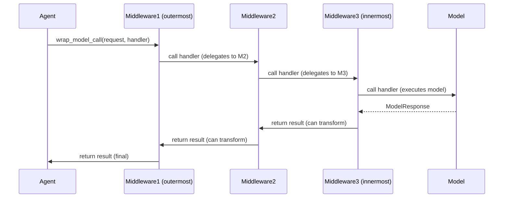

## Overview

Middleware in LangChain agents provides a composable, layered approach to intercepting and modifying agent behavior at well-defined execution points without changing core agent logic. Each middleware instance registers handler pairs (sync/async) for lifecycle hooks: initialization (`before_agent`), per-iteration model invocation (`before_model`, `wrap_model_call`, `after_model`), tool execution (`wrap_tool_call`), and completion (`after_agent`). Middleware composes by wrapping handlers in registration order, enabling cross-cutting concerns: automatic retries with exponential backoff, error handling and recovery, human-in-the-loop approval, tool argument validation, request/response transformation, and structured output handling.

### Core Architectural Principles

**Interception Model**: Middleware hooks into the agent execution loop at discrete points. Lifecycle hooks (`before_agent`, `before_model`, `after_model`, `after_agent`) run synchronously with the graph, returning optional state updates. Interception hooks (`wrap_model_call`, `wrap_tool_call`) receive a handler callback that executes the wrapped operation and can call it zero or more times, modify the request/response, or short-circuit entirely.

**Composition Semantics**: Middleware registered first becomes the outermost layer. In `wrap_model_call` chains, `[M1, M2, M3]` becomes `M1(M2(M3(model)))`: M1 receives control first and last, can observe or transform all inner results. Control flows inward through the stack when each middleware calls `handler(request)`, then flows outward as results propagate back.

**State and Command Flow**: Lifecycle hooks return optional state updates (`dict[str, Any] | None`). State updates merge using LangGraph reducers—`messages` field accumulates via `add_messages`; non-reducer fields overwrite. Interception hooks can return `ExtendedModelResponse` with optional `Command` objects from LangGraph, allowing middleware to redirect execution flow, jump to different nodes, or accumulate state updates that apply after the current node completes.

**Error Propagation**: Exceptions raised inside middleware (or by the wrapped operation) propagate up the stack unless explicitly handled. Control-flow signals (`interrupt`, `Command`) bypass error handling and always propagate. Middleware can convert exceptions to messages/errors or re-raise them.

## AgentMiddleware Protocol

All middleware classes inherit from `AgentMiddleware`, a generic base defining optional hooks.

### Type Parameters

```python
class AgentMiddleware(Generic[StateT, ContextT, ResponseT]):
    """
    StateT: Agent state type (default: AgentState[Any]).
    ContextT: Runtime context type (default: None).
    ResponseT: Structured response type (default: Any).
    """
```

### Lifecycle Hooks

Middleware can implement any subset of these hooks; unimplemented methods raise `NotImplementedError` if invoked in the wrong execution path (sync vs async).

#### Initialization Hooks

```python
def before_agent(self, state: StateT, runtime: Runtime[ContextT]) -> dict[str, Any] | None:
    """Runs once at agent start, before first model call."""

async def abefore_agent(self, state: StateT, runtime: Runtime[ContextT]) -> dict[str, Any] | None:
    """Async version of before_agent."""

def after_agent(self, state: StateT, runtime: Runtime[ContextT]) -> dict[str, Any] | None:
    """Runs after agent loop terminates (no more tool calls or explicit exit)."""

async def aafter_agent(self, state: StateT, runtime: Runtime[ContextT]) -> dict[str, Any] | None:
    """Async version of after_agent."""
```

#### Model Invocation Hooks

```python
def before_model(self, state: StateT, runtime: Runtime[ContextT]) -> dict[str, Any] | None:
    """Runs before each model invocation; can update state or set jump_to for control flow."""

async def abefore_model(self, state: StateT, runtime: Runtime[ContextT]) -> dict[str, Any] | None:
    """Async version of before_model."""

def after_model(self, state: StateT, runtime: Runtime[ContextT]) -> dict[str, Any] | None:
    """Runs after model response; can filter tool calls or update state."""

async def aafter_model(self, state: StateT, runtime: Runtime[ContextT]) -> dict[str, Any] | None:
    """Async version of after_model."""
```

#### Wrap Model Call (Core Interception)

```python
def wrap_model_call(
    self,
    request: ModelRequest[ContextT],
    handler: Callable[[ModelRequest[ContextT]], ModelResponse[ResponseT]],
) -> ModelResponse[ResponseT] | AIMessage | ExtendedModelResponse[ResponseT]:
    """Intercept and control model execution.
    
    Handler callback executes the model and returns ModelResponse.
    Middleware can:
    - Call handler once for normal execution
    - Call handler multiple times for retry logic
    - Skip handler to short-circuit (return cached or fallback result)
    - Modify request before calling handler
    - Transform response after handler returns
    
    Returns ModelResponse, AIMessage (auto-wrapped), or ExtendedModelResponse (with Command).
    """

async def awrap_model_call(
    self,
    request: ModelRequest[ContextT],
    handler: Callable[[ModelRequest[ContextT]], Awaitable[ModelResponse[ResponseT]]],
) -> ModelResponse[ResponseT] | AIMessage | ExtendedModelResponse[ResponseT]:
    """Async version of wrap_model_call."""
```

#### Wrap Tool Call (Tool Interception)

```python
def wrap_tool_call(
    self,
    request: ToolCallRequest,
    handler: Callable[[ToolCallRequest], ToolMessage | Command[Any]],
) -> ToolMessage | Command[Any]:
    """Intercept tool execution.
    
    Called once per tool call with full ToolCallRequest (tool call dict, BaseTool instance, state, runtime).
    Middleware can:
    - Call handler for normal execution
    - Call handler multiple times for retries
    - Skip handler to return cached result or mock
    - Modify tool args before handler
    - Convert exceptions to error ToolMessages
    
    Returns ToolMessage or Command.
    """

async def awrap_tool_call(
    self,
    request: ToolCallRequest,
    handler: Callable[[ToolCallRequest], Awaitable[ToolMessage | Command[Any]]],
) -> ToolMessage | Command[Any]:
    """Async version of wrap_tool_call."""
```

### Configuration

```python
class AgentMiddleware(Generic[StateT, ContextT, ResponseT]):
    state_schema: type[StateT] = AgentState[Any]
    """Optional custom state schema. Merged with base AgentState during graph compilation."""
    
    tools: Sequence[BaseTool] = ()
    """Additional tools registered by this middleware (e.g., ShellToolMiddleware adds shell_tool)."""
    
    trace_policy: TracePolicy | None = None
    """Optional trace policy controlling what is captured in spans for this middleware's hooks."""
    
    transformers: Sequence[TransformerFactory] = ()
    """Stream transformer factories for streaming customization."""
    
    @property
    def name(self) -> str:
        """The name of the middleware instance. Defaults to the class name; override for custom naming."""
```

## Composition and Execution Order

### Middleware Stack Architecture

When middleware is registered as `[M1, M2, M3]`, they compose into a stack where first becomes outermost:



**Execution Flow**:
1. M1's `wrap_model_call` is entered first (outermost)
2. M1 calls `handler()` → M2's `wrap_model_call` is entered
3. M2 calls `handler()` → M3's `wrap_model_call` is entered
4. M3 calls `handler()` → actual model execution
5. Model returns to M3 first; M3 can transform result
6. M3 returns to M2; M2 can transform result
7. M2 returns to M1; M1 can transform result and returns to agent

**Key Point**: Innermost middleware (M3, closest to model) sees the result first after model execution; outermost middleware (M1) sees and can override all inner transformations.

### State Updates and Command Accumulation

Lifecycle hooks return state updates merged via LangGraph reducers. For the `messages` field (using `add_messages` reducer), updates accumulate. Non-reducer fields are overwritten by the most recent update.

**Command Accumulation**: When middleware returns `ExtendedModelResponse` with `Command`, multiple commands are accumulated in a list (inner-to-outer order). The agent applies them sequentially after the model node completes through LangGraph state reducers.

**Reducer Semantics**:
- **Messages field**: Uses `add_messages` reducer, so messages in commands are **added** to existing messages, not replaced.
- **Non-reducer fields**: Later commands (from outer middleware) overwrite earlier ones (from inner middleware). This is "outermost-wins" semantics.

Example: If M1 and M3 both return commands with `{"status": "processing"}`, M1's value is used because M1 is outer.

### Middleware Stack Example

```python
from langchain.agents import create_agent
from langchain.agents.middleware import (
    ModelRetryMiddleware,
    ToolErrorMiddleware,
    HumanInTheLoopMiddleware,
)

agent = create_agent(
    model=ChatOpenAI(),
    tools=[search, calculator],
    middleware=[
        ModelRetryMiddleware(max_retries=2),  # M1: Outermost, retry model calls
        ToolErrorMiddleware(on_error=handle_error),  # M2: Middle, handle tool errors
        HumanInTheLoopMiddleware(interrupt_on={"delete": True}),  # M3: Innermost, approve risky tools
    ],
)
```

**Control flow**: M1 catches and retries model errors → M2 wraps tool execution and converts exceptions → M3 checks if tool should be approved before execution.

## Request and Response Types

### ModelRequest

```python
@dataclass
class ModelRequest(Generic[ContextT]):
    """Request context for model execution."""
    
    model: BaseChatModel              # The model to invoke
    messages: list[AnyMessage]        # Messages (excluding system message)
    system_message: SystemMessage | None  # System instructions
    tool_choice: Any                  # Tool selection strategy
    tools: list[BaseTool | dict]      # Available tools
    response_format: ResponseFormat[Any] | None  # Structured output format
    state: AgentState[Any]            # Full agent state
    runtime: Runtime[ContextT]        # Runtime context
    model_settings: dict[str, Any]    # Additional model parameters
```

**Immutable Pattern**: Middleware must not mutate `ModelRequest` directly. Use `request.override(**changes)` to create a new request with modifications. Direct attribute assignment is deprecated and raises `DeprecationWarning`.

```python
# ✅ Correct: use override()
new_request = request.override(
    system_message=SystemMessage(content="New instructions"),
    tools=[filtered_tools]
)

# ❌ Deprecated: direct assignment
request.system_message = ...  # Raises DeprecationWarning
```

### ModelResponse

```python
@dataclass
class ModelResponse(Generic[ResponseT]):
    """Successful model execution result."""
    
    result: list[BaseMessage]                  # Messages (typically one AIMessage)
    structured_response: ResponseT | None = None  # Parsed structured output
```

### ExtendedModelResponse

```python
@dataclass
class ExtendedModelResponse(Generic[ResponseT]):
    """Model response with optional LangGraph Command for additional state updates."""
    
    model_response: ModelResponse[ResponseT]
    command: Command[Any] | None = None
```

Middleware can return `ExtendedModelResponse` to apply a command that modifies state after the model node completes. Commands are applied through state reducers, so messages in commands are **added** to existing messages (not replaced). Non-reducer state fields in commands follow outermost-wins semantics: when multiple middleware return commands, the outermost middleware's values for non-reducer fields override inner ones, but `messages` fields accumulate.

### ToolCallRequest

```python
@dataclass
class ToolCallRequest:
    """Request context for tool execution."""
    
    tool_call: dict  # Tool call dict with 'id', 'name', 'args'
    tool: BaseTool | None  # Resolved BaseTool instance (or None in batch mode)
    state: AgentState[Any]  # Agent state at time of call
    runtime: ToolRuntime  # Runtime context with tool-specific info
```

## Core Middleware Types and Patterns

### Model Execution Middleware

#### ModelRetryMiddleware

Automatically retries failed model calls with exponential backoff when transient errors (rate limits, API timeouts) occur.

**Features**:
- Custom exception filtering: retry on tuple of exception types or callable predicate
- Configurable on_failure behavior: `"continue"` returns error message, `"error"` re-raises, or custom callable formats error
- Exponential backoff with configurable factor and delays
- Optional jitter to avoid thundering herd
- Skips non-retryable exceptions and lets them propagate immediately

```python
from langchain.agents.middleware import ModelRetryMiddleware

# Retry rate limits and timeouts with exponential backoff
retry = ModelRetryMiddleware(
    max_retries=3,
    retry_on=(RateLimitError, APITimeoutError),
    backoff_factor=2.0,
    initial_delay=1.0,
    jitter=True,
    on_failure="continue",  # Return error message instead of raising
)
```

#### ModelFallbackMiddleware

Wraps primary model with a fallback model (typically smaller/faster/cheaper) when primary fails.

#### ModelCallLimitMiddleware

Enforces maximum number of model calls per agent invocation, preventing runaway loops.

### Tool Execution Middleware

#### ToolErrorMiddleware

Converts tool execution exceptions into error `ToolMessage` objects sent back to the model, allowing recovery.

**Features**:
- `on_error` handler (sync) and `aon_error` handler (async) receive exception and `ToolCallRequest`
- Handler returns content (str or list of ContentBlock) to create error message, or None to propagate exception
- Opt-in by tool name: apply to specific tools or all tools
- Handles only tool execution exceptions; argument-binding errors are handled upstream
- Control-flow signals (interrupts, parent commands) always propagate

```python
from langchain.agents.middleware import ToolErrorMiddleware

def on_error(exc: Exception, request: ToolCallRequest) -> str | None:
    if isinstance(exc, ValueError):
        return f"Invalid argument for {request.tool_call['name']}: {exc}"
    return None  # Propagate other exceptions

middleware = ToolErrorMiddleware(on_error=on_error)
```

#### ToolRetryMiddleware

Retries failed tool calls with configurable backoff and validation logic. Similar configuration to `ModelRetryMiddleware` but operates on tool execution.

```python
from langchain.agents.middleware import ToolRetryMiddleware

# Retry network errors for search tool only
retry = ToolRetryMiddleware(
    max_retries=3,
    tools=["search"],
    retry_on=(ConnectionError, TimeoutError),
    backoff_factor=1.5,
)
```

#### ToolCallLimitMiddleware

Prevents infinite tool loops by enforcing maximum tool calls per thread or per run.

**Features**:
- Track calls per tool name or globally
- Separate thread-level (persistent) and run-level (per invocation) limits
- Exit behaviors: `"continue"` blocks exceeded tools, `"error"` raises exception, `"end"` stops immediately with explanatory messages

```python
from langchain.agents.middleware.tool_call_limit import ToolCallLimitMiddleware

limiter = ToolCallLimitMiddleware(
    thread_limit=20,  # Max 20 calls per thread
    run_limit=10,     # Max 10 calls per run
    exit_behavior="end",  # Stop with messages when exceeded
)
```

### Control Flow & Approval Middleware

#### HumanInTheLoopMiddleware

Pauses after model-requested tool calls and sends an interrupt for human review.

**Modes**:
- **Batched** (default): One interrupt per model turn with all tool calls listed
- **Per-call**: Interrupt for each tool call individually

**Features**:
- Constructs `ActionRequest` objects for each tool call
- Supports approval, editing, rejection, or human-answered decisions
- Approval: tool call proceeds unchanged
- Edit: human-provided arguments override model's
- Reject: blocks tool execution; model receives error message
- Respond: skips execution; returns synthetic ToolMessage with human's answer

```python
from langchain.agents.middleware import HumanInTheLoopMiddleware

hitl = HumanInTheLoopMiddleware(
    mode="batched",  # One interrupt per model turn
    interrupt_on={
        "delete_file": True,  # Require approval for all decisions
        "search": {
            "allowed_decisions": ["approve", "reject"],  # Limit options
            "description": "Searching online databases",
        },
    }
)
```

### Data Transformation & Privacy Middleware

#### PIIMiddleware

Detects personally identifiable information in prompts, model responses, and tool outputs; optionally redacts or transforms it.

**Features**:
- Configurable detectors and redaction rules
- Detects PII before model sees it (in prompts)
- Redacts PII in model responses to user
- Tracks sensitive data for audit trails

#### ContextEditingMiddleware

Allows dynamic modification of agent context (system message, available tools) during execution based on state or runtime conditions.

#### FileSearchMiddleware

Integrates file search capabilities, retrieving relevant documents before model calls.

### System Tools Middleware

#### ShellToolMiddleware

Provides controlled shell command execution with configurable resource limits, sandboxing, timeout enforcement, and output truncation.

**Features**:
- Multiple sandboxing modes: host, Docker, Codex
- Resource limits: timeouts, output line limits, memory constraints
- Environment variable configuration
- Workspace isolation

#### TodoListMiddleware

Adds persistent todo list management capability for multi-step task tracking.

## Writing Custom Middleware

### Simple Example: Logging Middleware

```python
from langchain.agents.middleware import AgentMiddleware

class LoggingMiddleware(AgentMiddleware):
    def before_model(self, state, runtime):
        num_messages = len(state.get("messages", []))
        print(f"[before_model] {num_messages} messages in state")
        return None  # No state updates

    def after_model(self, state, runtime):
        last_msg = state["messages"][-1] if state["messages"] else None
        if hasattr(last_msg, 'tool_calls'):
            print(f"[after_model] Model requested {len(last_msg.tool_calls)} tools")
        return None
```

### Retry Logic with Exponential Backoff

```python
import time
from langchain.agents.middleware import AgentMiddleware, ModelResponse
from langchain_core.messages import AIMessage

class CustomRetryMiddleware(AgentMiddleware):
    def __init__(self, max_retries: int = 2, backoff_factor: float = 2.0):
        super().__init__()
        self.max_retries = max_retries
        self.backoff_factor = backoff_factor

    def wrap_model_call(self, request, handler):
        for attempt in range(self.max_retries + 1):
            try:
                return handler(request)
            except (TimeoutError, ConnectionError) as e:
                if attempt < self.max_retries:
                    delay = self.backoff_factor ** attempt
                    time.sleep(delay)
                else:
                    # Return error message instead of raising
                    return ModelResponse(
                        result=[AIMessage(content=f"Model call failed: {e}")]
                    )
```

### Tool Argument Validation and Modification

```python
from langchain.agents.middleware import AgentMiddleware
from langchain_core.messages import ToolMessage

class ArgumentValidationMiddleware(AgentMiddleware):
    def wrap_tool_call(self, request, handler):
        tool_call = request.tool_call
        args = tool_call["args"]
        
        # Example: normalize string args to lowercase for search tool
        if tool_call["name"] == "search":
            args = {k: v.lower() if isinstance(v, str) else v for k, v in args.items()}
            request = request.override(tool_call={**tool_call, "args": args})
        
        return handler(request)
```

### Conditional Tool Interception Based on State

```python
from langchain.agents.middleware import AgentMiddleware
from langchain_core.messages import ToolMessage

class ConditionalToolMiddleware(AgentMiddleware):
    def wrap_tool_call(self, request, handler):
        state = request.state
        
        # Find the latest user message
        user_message = next(
            (m.content for m in reversed(state["messages"]) if hasattr(m, "content")),
            None
        )
        
        # Only allow search if user explicitly requests it
        if "search" not in user_message.lower() and request.tool_call["name"] == "search":
            return ToolMessage(
                content="Search requires explicit user approval.",
                tool_call_id=request.tool_call["id"],
                name=request.tool_call["name"],
                status="error",
            )
        
        return handler(request)
```

### Returning Commands from Middleware

```python
from langchain.agents.middleware import AgentMiddleware, ExtendedModelResponse
from langgraph.types import Command

class CommandReturningMiddleware(AgentMiddleware):
    def wrap_model_call(self, request, handler):
        response = handler(request)
        
        # Return ExtendedModelResponse with Command for additional state updates
        return ExtendedModelResponse(
            model_response=response,
            command=Command(update={"custom_field": "custom_value"})
        )
```

## Async and Sync Implementations

Middleware can provide sync-only, async-only, or both implementations. The agent will:

- Call sync versions (`wrap_model_call`, `wrap_tool_call`) in sync contexts (`stream()`, `invoke()`).
- Call async versions (`awrap_model_call`, `awrap_tool_call`) in async contexts (`astream()`, `ainvoke()`).
- Raise `NotImplementedError` if the required implementation is missing for the execution path, with guidance to implement both versions or use the appropriate execution mode.

**Best Practice**: Implement both versions unless the middleware is inherently async-only (uses async I/O).

```python
from langchain.agents.middleware import AgentMiddleware, ModelResponse

class DualImplementationMiddleware(AgentMiddleware):
    def wrap_model_call(self, request, handler):
        print("Sync wrap_model_call")
        return handler(request)
    
    async def awrap_model_call(self, request, handler):
        print("Async wrap_model_call")
        return await handler(request)
```

## Integration with Agent Factory

Middleware is passed to `create_agent()` as a list:

```python
from langchain.agents import create_agent
from langchain.agents.middleware import (
    ModelRetryMiddleware,
    ToolErrorMiddleware,
    HumanInTheLoopMiddleware,
)

agent = create_agent(
    model=ChatOpenAI(),
    tools=[search, calculator],
    middleware=[
        ModelRetryMiddleware(max_retries=2),  # Outermost: retry model calls
        ToolErrorMiddleware(on_error=my_handler),  # Middle: handle tool errors
        HumanInTheLoopMiddleware(interrupt_on={"delete": True}),  # Innermost: approve risky tools
    ],
)
```

**Composition Rule**: First in the list = outermost (highest priority for interception and response transformation). The factory collects middleware with `wrap_model_call` hooks, composes them into a single middleware stack, establishing an order where the first middleware becomes the outermost layer. Commands from each layer are accumulated in inner-to-outer order and applied sequentially after model execution through LangGraph's reducer-based state system.

## Tracing and Observability

### Trace Policy

Middleware can configure what gets traced via `trace_policy`:

```python
from langchain.agents.middleware import TracePolicy, omit_payload

class MyMiddleware(AgentMiddleware):
    trace_policy = TracePolicy(process_inputs=omit_payload)
    # Omit input payloads from traces, keep spans and timing
```

### Hook Naming in Traces

Middleware hooks are automatically named in trace spans as `{middleware_name}.{hook_name}`, e.g., `ModelRetryMiddleware.wrap_model_call`, making it easy to identify which middleware handled each span.

## Common Patterns and Anti-Patterns

### ✅ Good Patterns

1. **Immutable Requests**: Use `request.override()` instead of mutating fields.
2. **Opt-in Error Handling**: Return `None` from error handlers to propagate exceptions; don't silently swallow errors.
3. **State-Driven Decisions**: Use `request.state` and `runtime` to make decisions; avoid global state.
4. **Clear Composition Order**: Document which middleware should run first, especially when order matters (e.g., retry before error handling).
5. **Fallback Behavior**: Implement sync and async versions to support both execution paths.
6. **Command Ordering**: When returning Commands, consider that multiple middleware commands stack—outermost middleware's non-reducer fields win.

### ❌ Anti-Patterns

1. **Mutating Request/Response Objects**: Direct assignment to `ModelRequest` fields is deprecated; always use `override()`.
2. **Silent Failures**: Don't catch and suppress exceptions in `on_error` handlers without returning content; let exceptions propagate if not handled.
3. **Hard-Coded Assumptions**: Don't assume specific tool names or message formats without validation.
4. **Blocking Async**: Never use `asyncio.run()` or sync I/O in async middleware implementations.
5. **Over-Composition**: Don't add more middleware than necessary; each layer adds latency.
6. **Ignoring Command Semantics**: Don't assume Command fields will accumulate like messages; remember that non-reducer fields follow outermost-wins semantics.

## Key Invariants and Lifecycle

- **Immutability**: `ModelRequest` and `ToolCallRequest` follow an immutable pattern; use `override()` or `replace()` methods.
- **Execution Order**: Middleware runs in registration order (first = outermost). Multiple calls within a middleware (retries) do not reorder subsequent middleware.
- **State Reducer Semantics**: State updates via dict returns merge using reducer semantics. Messages accumulate via `add_messages`; non-reducer fields are overwritten by the most recent update.
- **Command Flow**: `ExtendedModelResponse` commands are collected (inner-to-outer) and applied after the model node completes through LangGraph reducers.
- **Sync/Async Consistency**: Choosing execution path (sync or async) is determined at agent invocation time; middleware cannot switch contexts mid-execution.
- **Exception Propagation**: Exceptions that are not explicitly handled propagate to the caller, unless a middleware converts them to a message or command.

## See Also

- [Agent Execution Flow and Loop Control](/openwiki/agent-execution.md) – Detailed description of the agent loop, state management, and where middleware hooks are invoked.
- [Agent Factory and Graph Construction](/openwiki/agent-factory.md) – How the agent graph is built, including middleware integration and handler composition.
- [Composability: Building Complex Agents](/openwiki/composability.md) – Patterns for composing agents through middleware layers and subagent delegation.
