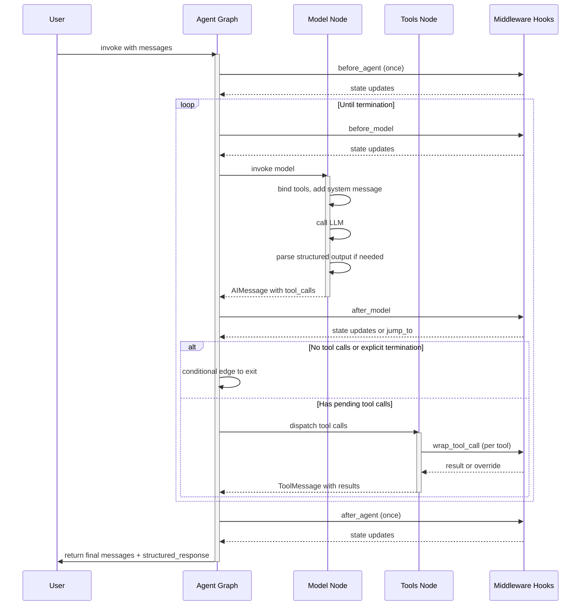

## Overview

The LangChain agent system (`create_agent` in `factory.py`) builds a compiled LangGraph `StateGraph` that orchestrates a structured, loop-based execution model. An agent processes user input through a sequence of nodes: initialization hooks, model invocation, tool dispatch, and termination logic, all mediated by pluggable middleware that can intercept and modify behavior at each stage.

The agent loop operates as a state machine with conditional edges that determine whether to invoke tools, retry the model, jump to alternative nodes, or terminate based on tool results and structured output.

## Agent State and Schema

The agent maintains an `AgentState` with three core fields:

- **`messages`** – The conversation history, reduced via `add_messages` to accumulate messages across loop iterations. Each message is either a `UserMessage`, `AIMessage`, `ToolMessage`, or `SystemMessage`.
- **`structured_response`** – Optional parsed output when `response_format` is specified; omitted from input schema but available in output.
- **`jump_to`** – Ephemeral internal field for middleware to request jumping to specific nodes (`"model"`, `"tools"`, or `"end"`).

Middleware can extend this base schema by defining their own `state_schema` typed dict. All schemas are merged during agent creation, with the explicit `state_schema` parameter winning conflicts.

## Core Execution Flow

This diagram shows the high-level flow: initialization, the repeating model-invoke-and-dispatch loop mediated by hooks, and final cleanup.

## Execution Phases

### 1. Entry Initialization (`before_agent`)

When the graph is invoked, the first node runs any middleware `before_agent` hooks in sequence (if declared). Each hook:
- Receives the current state and runtime context.
- Returns optional state updates (e.g., prepending system context, adjusting message format).
- Runs exactly once per agent invocation.

If no `before_agent` hook is defined, the agent skips directly to `before_model` or `model`.

### 2. Model Invocation

The model node prepares a `ModelRequest` with:
- The language model instance.
- Messages from state (after patching invalid tool calls).
- System message (if provided at creation time).
- Available tools list.
- Current response format (structured output specification).
- Runtime context.

**Middleware wrapping:** If any middleware implements `wrap_model_call` (sync) or `awrap_model_call` (async), the handlers compose into a middleware stack (first declared = outermost layer). Each middleware can:
- Retry the model by calling the handler multiple times.
- Short-circuit by returning a cached result without calling the handler.
- Modify the request before passing to the handler.
- Transform the response (e.g., rewrite content, inject structured data).

**Model execution:** The composed handler invokes the actual model:
1. Binds tools and response format to the model instance.
2. Calls the model's `invoke` or `ainvoke` with the message history.
3. Processes the output:
   - For **provider-native structured output** (ProviderStrategy), parses the structured response directly from the model output.
   - For **tool-based structured output** (ToolStrategy), checks if the model called a structured output tool and parses its arguments.
   - For standard tool calls, returns the `AIMessage` with tool_calls intact.
4. Returns a `ModelResponse` containing the messages and optional structured response.

**Pre-model hooks:** Before the model is called, any `before_model` middleware hooks run, allowing final adjustments to messages or request state.

**Post-model hooks:** After the model returns, any `after_model` hooks run, receiving the updated state with the model's response. They can update state or set `jump_to` to override the default routing logic.

### 3. Conditional Routing (Model to Next)

After the model responds, the graph uses the `loop_exit_node` (typically `after_model` if defined, else `model`) to decide what happens next:

- **Explicit jump_to:** If a `before_model` or `after_model` hook sets `state["jump_to"]` to `"model"`, `"tools"`, or `"end"`, that destination is used.
- **Structured output produced:** If `state["structured_response"]` is not None (fresh from this call), exit to `end_destination`.
- **Tool calls with pending executions:** If the AIMessage has `tool_calls` and some are not yet answered (no matching `ToolMessage` exists), send each pending tool call to the tools node.
- **Synthetic tool messages:** If the AIMessage has tool_calls but no pending calls remain (middleware injected `ToolMessage`s), loop back to `model` for reprocessing.
- **No tool calls:** If the AIMessage has no `tool_calls`, exit to the end node.

### 4. Tool Execution

The tools node runs when there are pending tool calls:

1. **Tool lookup:** For each pending tool call, find the corresponding `BaseTool` in the `ToolNode`.
2. **Middleware wrapping:** If any middleware implements `wrap_tool_call` (sync) or `awrap_tool_call` (async), compose the wrappers (first = outermost). Each wrapper can:
   - Retry the tool.
   - Short-circuit with a cached or fallback result.
   - Redirect execution to a different tool.
   - Log or audit the call.
3. **Execution:** Call the tool with the provided arguments.
4. **Result:** Return a `ToolMessage` containing the output, or a `Command` for more complex state updates.

Tools node also handles return_direct: if all executed tools have `return_direct=True`, routing exits the loop after tool execution.

### 5. Loop Back or Exit

After tools execute, the `tools_to_model_edge` decides:

- **return_direct on all tools:** Exit to end.
- **Structured output tool executed:** Exit to end (structured response is complete).
- **Otherwise:** Loop back to `before_model` (or `model` if no `before_model` hook) to process results.

### 6. Exit Finalization (`after_agent`)

After the loop terminates, any `after_agent` hooks run in reverse order (last declared = first to run). These hooks:
- Receive the final state.
- Can perform cleanup, logging, or final state mutations.
- Run exactly once at the very end, before the graph returns.

## Middleware Integration

Middleware is registered when calling `create_agent(middleware=[...])`. Each middleware instance is a subclass of `AgentMiddleware` and can define:

- **Lifecycle hooks** – `before_agent`, `abefore_agent`, `before_model`, `abefore_model`, `after_model`, `aafter_model`, `after_agent`, `aafter_agent`.
- **Model call wrapping** – `wrap_model_call`, `awrap_model_call` for retry, caching, or fallback logic.
- **Tool call wrapping** – `wrap_tool_call`, `awrap_tool_call` for audit, retry, or redirection.
- **State extension** – `state_schema` to add custom fields to the agent state.
- **Tools** – Additional tools made available to the model via the middleware.
- **Transformers** – Stream transformers for observability or message transformation.
- **Trace policy** – Optional policy to control what is logged to LangSmith.

### Middleware Composition

- **Multiple middleware:** Middleware instances are composed in registration order (first = outermost layer).
- **before_agent chain:** Run in order; each passes to the next.
- **before_model chain:** Run in order; each passes to the next; the last feeds to `model`.
- **after_model chain:** Run in reverse order (last = first to execute).
- **after_agent chain:** Run in reverse order (last = first to execute).

Each hook node can return state updates or set `jump_to` to redirect the flow.

## Structured Output Handling

When `response_format` is provided to `create_agent`, the agent supports two strategies:

### ProviderStrategy

The model natively supports structured output (e.g., OpenAI's `response_format`, Claude's `tool_choice`). The model is bound with the response format, and the model's output is parsed directly to extract the structured response.

### ToolStrategy

The structured output is represented as a tool the model can call. When the model invokes the structured output tool:
1. The tool's arguments are parsed as the structured response.
2. A `ToolMessage` confirms the tool call.
3. The loop exits.

### Auto-Detection

When a raw Pydantic model or dict schema is passed as `response_format`, the agent auto-detects the best strategy based on model capabilities at runtime. Provider-native support is checked first; if unavailable, `ToolStrategy` is used.

## Error Handling and Validation

### Invalid Tool Calls

If the model produces malformed tool calls (truncated or invalid arguments), they are patched before the next model invocation. A synthetic `ToolMessage` explains the error, allowing the model to retry.

### Structured Output Validation

If parsing a structured output schema fails:
- The error is caught and handled according to `response_format.handle_errors`.
- If configured to retry, a `ToolMessage` with the error is added; the loop repeats.
- If not configured to retry, the validation error is raised.

### Dynamic Tool Errors

If middleware adds tools via `wrap_model_call` that weren't registered upfront, a `ValueError` is raised unless `wrap_tool_call` is defined to handle dynamic tool execution.

## Graph Structure

The compiled graph includes:

- **model** node – Invokes the language model, returns Commands with updated messages and structured_response.
- **tools** node – Executes pending tool calls (if tools exist).
- **Middleware nodes** – One per hook per middleware: `{middleware.name}.before_agent`, `{middleware.name}.before_model`, `{middleware.name}.after_model`, `{middleware.name}.after_agent`.
- **START** – Entry point, connects to the first middleware or `model` node.
- **END** – Exit point, reached after the loop terminates.

### Conditional Edges

- **model → tools/exit** – Decided by `_make_model_to_tools_edge`: routes based on pending tool calls and structured output completion.
- **tools → model/exit** – Decided by `_make_tools_to_model_edge`: routes based on return_direct and tool execution success.
- **Middleware jump edges** – If a middleware hook declares `can_jump_to` targets, the graph adds conditional edges to enable middleware to redirect flow.

### Recursion and Limits

The graph is compiled with `recursion_limit=9_999` to support long agentic loops without premature cutoff.

## Request and Response Types

### ModelRequest

Contains all information needed to invoke the model:
- **model** – The `BaseChatModel` instance.
- **messages** – Conversation history (excludes system message).
- **system_message** – Optional `SystemMessage` to prepend.
- **tools** – List of available `BaseTool` instances and built-in tool dicts.
- **tool_choice** – Optional tool choice constraint.
- **response_format** – Optional structured output specification.
- **state** – The full agent state.
- **runtime** – LangGraph `Runtime` for access to context and store.
- **model_settings** – Additional kwargs to pass to `model.bind_tools()`.

Middleware can use `request.override()` to create a new request with selective modifications (immutable pattern).

### ModelResponse

The result of model invocation:
- **result** – List of messages (typically a single `AIMessage`, or `AIMessage` + `ToolMessage` for tool-based structured output).
- **structured_response** – Parsed structured data if `response_format` was specified and successfully parsed.

### ExtendedModelResponse

Used in `wrap_model_call` to return a model response alongside an optional `Command` for additional state updates. Commands may not use `goto`, `resume`, or `graph` (not yet supported).

## Execution Variants

### Sync vs. Async

- **Sync execution** – Graph uses `model_node` and sync middleware hooks (`before_agent`, `before_model`, etc.). Tools node executes synchronously.
- **Async execution** – Graph uses `amodel_node` and async hooks (`abefore_agent`, `abefore_model`, etc.). Tools node executes asynchronously.

The framework automatically picks sync or async based on which hooks and methods are implemented. If only async is defined but sync is used, a `NotImplementedError` is raised with guidance to implement the sync version or use async invocation.

### No Tools

If no tools are provided and no middleware adds tools, the graph consists of just the model node and exit. The loop terminates immediately after the first model invocation.

## Configuration and Operations

### Parameters to create_agent

- **model** – String identifier or `BaseChatModel` instance.
- **tools** – Optional list of `BaseTool`, callable, or tool dict.
- **system_prompt** – Optional system message content.
- **middleware** – Sequence of `AgentMiddleware` instances.
- **response_format** – Optional `ToolStrategy`, `ProviderStrategy`, or Pydantic schema.
- **state_schema** – Optional custom state schema extending `AgentState`.
- **context_schema** – Optional runtime context schema.
- **checkpointer** – Optional checkpoint saver for persistence.
- **store** – Optional cross-thread data store.
- **interrupt_before/interrupt_after** – Optional node names to interrupt at.
- **debug** – Enable verbose logging.
- **cache** – Optional execution cache.
- **transformers** – Optional stream transformer factories.

### Checkpointing and Persistence

When a `checkpointer` is provided, the graph persists state to disk or a remote store. Each invocation with a `thread_id` in the config retrieves the prior state and resumes from there, enabling multi-turn conversations and pause-resume workflows.

### Observability and Tracing

- Each middleware hook is wrapped with `@traceable` from LangSmith, capturing inputs, outputs, duration, and errors.
- Trace policies on middleware can filter what is recorded (e.g., `omit_payload` to redact message content).
- Built-in stream transformers (e.g., `ToolCallTransformer`) provide finer-grained observability.

## Extension Points

1. **Custom middleware** – Subclass `AgentMiddleware` and implement any hooks or wrappers.
2. **State extensions** – Define a custom `state_schema` TypedDict and merge it via middleware.
3. **Tool wrapping** – Use `wrap_tool_call` to intercept, retry, or redirect tool execution.
4. **Model wrapping** – Use `wrap_model_call` for caching, fallback, or retrying model invocations.
5. **Stream transformers** – Register custom transformer factories to reshape or filter stream output.
6. **Conditional edges** – Middleware can return `jump_to` to override default routing logic.
7. **Dynamic tools** – Middleware can return tools in `wrap_model_call` if `wrap_tool_call` is defined to handle them.

## Testing and Debugging

- **debug=True** – Enable verbose logging to trace node execution and state transitions.
- **Model simulation** – Use `AIMessage` mocks in tests to simulate model responses without calling the actual LLM.
- **Middleware isolation** – Test individual middleware hooks in isolation by calling them with mock `state` and `runtime`.
- **Graph inspection** – Use `graph.get_graph()` to inspect the compiled graph structure and edges.
