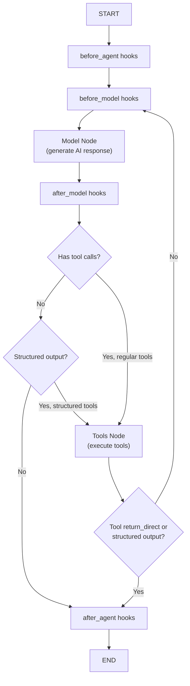

# Agent Execution: Building Agentic Workflows

Agent execution in LangChain is built on a composable architecture where language models repeatedly plan, invoke tools, and interpret results in a structured loop. The [`create_agent`][langchain.agents.create_agent] factory function constructs this agentic loop by orchestrating:

1. **Model binding** (tools + system prompt)
2. **Middleware composition** (pre/post hooks and wrapper handlers)
3. **Tool execution** (ToolNode with middleware wrapping)
4. **Conditional state routing** (planning vs. tool use vs. termination)

This document explains the patterns, control flow, and extension points for building production agents.

## Architecture: Model + Tools + Middleware

### Agent State and Lifecycle

Every agent operates over an `AgentState` that persists messages, tracks routing decisions, and holds optional structured outputs:

```python
class AgentState(TypedDict, Generic[ResponseT]):
    """State schema for the agent."""
    messages: Required[Annotated[list[AnyMessage], add_messages]]
    jump_to: NotRequired[Annotated[JumpTo | None, EphemeralValue]]
    structured_response: NotRequired[Annotated[ResponseT, OmitFromOutput]]
```

- **messages**: The conversation history, merged using `add_messages` reducer (new messages append).
- **jump_to**: An ephemeral routing hint set by middleware to direct flow ("tools", "model", or "end").
- **structured_response**: Parsed output (when `response_format` is configured).

### Agent Loop Phases

The agent loop has three core phases:

1. **Model Node**: Calls the language model with current messages + tools. Returns an `AIMessage` with optional `tool_calls`.
2. **Tools Node**: Executes tool calls, returning `ToolMessage` results.
3. **Routing**: Decides whether to loop back (more tools needed), skip tools (structured output), or terminate (no tool calls).

Middleware hooks intercept at each phase:
- `before_agent`, `after_agent`: Wrap the entire agent execution (once at start/end).
- `before_model`, `after_model`: Wrap each model invocation (multiple times in a loop).
- `wrap_model_call`: Intercept model execution (retry, caching, fallback).
- `wrap_tool_call`: Intercept tool execution (validation, retry, monitoring).

## Creating an Agent with `create_agent`

### Minimal Example

```python
from langchain.agents import create_agent
from langchain_openai import ChatOpenAI

def search(query: str) -> str:
    """Search for information."""
    return f"Results for {query}"

agent = create_agent(
    model="openai:gpt-4o",
    tools=[search],
    system_prompt="You are a helpful assistant"
)

# Run the agent
result = agent.invoke({"messages": [{"role": "user", "content": "Search for AI news"}]})
print(result["messages"][-1].content)
```

### Factory Signature

```python
def create_agent(
    model: str | BaseChatModel,
    tools: Sequence[BaseTool | Callable[..., Any] | dict[str, Any]] | None = None,
    *,
    system_prompt: str | SystemMessage | None = None,
    middleware: Sequence[AgentMiddleware[StateT_co, ContextT]] = (),
    response_format: ResponseFormat[ResponseT] | type[ResponseT] | None = None,
    state_schema: type[AgentState[ResponseT]] | None = None,
    context_schema: type[ContextT] | None = None,
    checkpointer: Checkpointer | None = None,
    store: BaseStore | None = None,
    interrupt_before: list[str] | None = None,
    interrupt_after: list[str] | None = None,
    debug: bool = False,
    name: str | None = None,
    cache: BaseCache[Any] | None = None,
    transformers: Sequence[TransformerFactory] | None = None,
) -> CompiledStateGraph[AgentState[ResponseT], ContextT, InputAgentState, OutputAgentState[ResponseT]]
```

### Key Parameters

| Parameter | Purpose | Notes |
|-----------|---------|-------|
| `model` | Language model | String (e.g., `"openai:gpt-4o"`) or `BaseChatModel` instance |
| `tools` | Tool functions/schemas | `BaseTool`, callables, or dict schemas; can be empty |
| `system_prompt` | Instructions for the model | String or `SystemMessage`; prefixed to every model call |
| `middleware` | Pre/post hooks and wrappers | Ordered list; first = outermost layer |
| `response_format` | Structured output schema | `ToolStrategy`, `ProviderStrategy`, or Pydantic class |
| `state_schema` | Custom state fields | Extends `AgentState` with application state |
| `checkpointer` | Conversation memory | Saves state per thread; enables resumption |
| `store` | Cross-thread persistence | Retrieve context across conversations |
| `interrupt_before/after` | Human-in-the-loop | Pause before/after named nodes |
| `debug` | Verbose logging | Prints execution trace |
| `transformers` | Stream output formatters | Custom `StreamTransformer` factories |

## Tool Binding and Execution

### Tool Types

Tools are bound to the model during agent creation. The factory accepts three formats:

1. **BaseTool instances** (preferred):
   ```python
   from langchain_core.tools import tool
   
   @tool
   def search(query: str) -> str:
       """Search for information."""
       return f"Results for {query}"
   
   agent = create_agent(model="openai:gpt-4o", tools=[search])
   ```

2. **Python callables** (auto-wrapped):
   ```python
   def search(query: str) -> str:
       """Search for information."""
       return f"Results for {query}"
   
   agent = create_agent(model="openai:gpt-4o", tools=[search])
   ```

3. **Dict schemas** (provider built-ins):
   ```python
   tools = [
       {
           "type": "builtin_text_search",  # Provider-specific
           "name": "search",
           "description": "Search for information"
       }
   ]
   agent = create_agent(model="anthropic:claude-opus", tools=tools)
   ```

### Tool Node and Execution

When tools are provided, `create_agent` constructs a `ToolNode` that:

1. Receives the model's `AIMessage` with `tool_calls`.
2. Matches each call to a registered tool.
3. Executes the tool (sync or async).
4. Returns `ToolMessage` with the result.
5. Applies middleware wrappers (`wrap_tool_call`, `awrap_tool_call`).

The ToolNode validates that:
- All tool names referenced by the model are registered.
- Tools return proper result strings/structured data.
- Exceptions are caught and returned as error `ToolMessage` objects.

### Model Binding and Structured Output

Before calling the model, `create_agent` binds tools using `model.bind_tools()`:

```python
bound_model = model.bind_tools(
    final_tools,
    tool_choice=tool_choice,  # "any", "required", specific name, or None
    **model_settings
)
```

**Structured output** (when `response_format` is configured) adds special tools:

- **ProviderStrategy**: Uses the model's native structured output API (e.g., OpenAI's `response_format`).
- **ToolStrategy**: Creates pseudo-tools for each schema; model calls the tool to return structured data.
- **AutoStrategy**: Auto-detects the best strategy based on model capabilities.

When ToolStrategy is used, the agent automatically:
1. Adds structured tools to the model's tool list.
2. Executes the tool call to parse the schema.
3. Stores the parsed result in `state["structured_response"]`.
4. Routes to termination (not looping back for more tools).

## Middleware: Hooks and Wrappers

Middleware instances allow customization at every stage of agent execution. They inherit from `AgentMiddleware` and implement any combination of hooks and wrappers.

### Hook-Based Middleware (Node Hooks)

Node hooks are called once per agent node invocation, returning state updates:

```python
class MyMiddleware(AgentMiddleware):
    def before_agent(self, state: AgentState, runtime: Runtime) -> dict[str, Any] | None:
        """Called once before agent execution starts."""
        # Inject initial state, validate inputs, etc.
        return {"custom_field": "value"}
    
    def after_agent(self, state: AgentState, runtime: Runtime) -> dict[str, Any] | None:
        """Called once after agent execution completes."""
        # Log final state, cleanup, etc.
        return None
    
    def before_model(self, state: AgentState, runtime: Runtime) -> dict[str, Any] | None:
        """Called before each model invocation (runs in loop)."""
        # Modify messages, set tool constraints, etc.
        return None
    
    def after_model(self, state: AgentState, runtime: Runtime) -> dict[str, Any] | None:
        """Called after each model invocation (runs in loop)."""
        # Validate model output, log decisions, etc.
        return None
```

Hooks can set `state["jump_to"]` to alter routing:
- `"model"`: Jump to model node (skip tools, loop back).
- `"tools"`: Jump to tools node (execute tools).
- `"end"`: Skip to agent termination.

### Wrapper-Based Middleware (Handler Wraps)

Wrappers intercept and control core operations by wrapping handler callbacks:

#### `wrap_model_call` – Model Retry and Caching

```python
from langchain.agents import ModelRequest, ModelResponse, AgentMiddleware

class RetryMiddleware(AgentMiddleware):
    def wrap_model_call(self, request: ModelRequest, handler):
        """Retry model call up to 3 times on error."""
        for attempt in range(3):
            try:
                response = handler(request)  # Call the model
                return response
            except Exception as e:
                if attempt == 2:
                    raise
                print(f"Attempt {attempt + 1} failed: {e}")
```

`wrap_model_call` can:
- **Retry** on transient errors.
- **Cache** responses by request hash.
- **Fallback** to a different model.
- **Modify request** (tools, system message, model settings).
- **Rewrite response** (transform AI message content).

Returns:
- `ModelResponse`: Full response with messages and optional structured output.
- `AIMessage`: Simplified response (auto-converted to `ModelResponse`).
- `ExtendedModelResponse`: Response + `Command` for additional state updates.

#### `wrap_tool_call` – Tool Validation and Retry

```python
class ToolRetryMiddleware(AgentMiddleware):
    def wrap_tool_call(self, request: ToolCallRequest, handler):
        """Retry tool execution if result is invalid."""
        for attempt in range(2):
            result = handler(request)  # Execute the tool
            if self._is_valid(result):
                return result
        return result
    
    def _is_valid(self, result):
        # Custom validation logic
        return "error" not in result.content.lower()
```

`wrap_tool_call` can:
- **Validate** tool arguments before execution.
- **Retry** on errors or invalid outputs.
- **Monitor** tool usage and cost.
- **Modify calls** (transform arguments, inject context).
- **Mock** tools for testing.

Returns:
- `ToolMessage`: Tool execution result.
- `Command`: Route to a different node or update state.

### Middleware Composition and Ordering

Middleware is applied in **first-in, outermost** order:

```python
middleware = [CacheMiddleware(), RetryMiddleware(), LoggingMiddleware()]
agent = create_agent(model="openai:gpt-4o", tools=[...], middleware=middleware)
```

**Execution order:**
- Model call: `CacheMiddleware` → `RetryMiddleware` → `LoggingMiddleware` → actual model
- Response: actual model → `LoggingMiddleware` → `RetryMiddleware` → `CacheMiddleware`

**State schema composition:**
Middleware state schemas are merged in order, with later schemas overriding earlier fields. The agent's `state_schema` parameter (if provided) always wins conflicts.

## Agent Execution Flow

### Synchronous vs. Asynchronous

`create_agent` returns a compiled graph that supports both sync and async:

```python
# Synchronous
result = agent.invoke({"messages": [...]})

# Asynchronous
result = await agent.ainvoke({"messages": [...]})

# Streaming (sync)
for chunk in agent.stream({"messages": [...]}, stream_mode="updates"):
    print(chunk)

# Streaming (async)
async for chunk in agent.astream({"messages": [...]}):
    print(chunk)
```

The graph automatically chooses sync or async based on the execution context. If a middleware implements only async (`awrap_model_call`) and is invoked synchronously, it raises `NotImplementedError`. Provide both implementations for maximum compatibility.

### Control Flow Diagram



### Detailed Execution Steps

1. **Initialization** (`before_agent`):
   - Middleware `before_agent` hooks run once, allowing setup and state injection.
   - State updates are merged using reducers (e.g., `add_messages` for messages).

2. **Loop iteration**:
   - **before_model**: Hooks run, allowing message filtering, tool narrowing, etc.
   - **model**: Model is called with current messages + system prompt + bound tools.
   - **after_model**: Hooks run for logging, validation, or routing overrides.

3. **Routing decision**:
   - If `AIMessage` has `tool_calls`: Route to tools node.
   - If `state["jump_to"] == "model"`: Loop back to `before_model`.
   - If `state["jump_to"] == "end"`: Skip to termination.
   - If no tool calls and no structured output: Route to termination.

4. **Tool execution**:
   - Each tool call is matched to a registered tool.
   - `wrap_tool_call` middleware intercepts execution.
   - Tool result is wrapped in a `ToolMessage`.
   - If any tool has `return_direct=True` or structured output was produced: Skip tools loop, go to termination.
   - Otherwise: Loop back to `before_model`.

5. **Termination** (`after_agent`):
   - Middleware `after_agent` hooks run once for cleanup, logging, or final state updates.
   - Graph returns the final state (messages + optional structured response).

## Common Middleware Patterns

### Pattern 1: Tool Selection and Routing

Narrow the tools available to the model based on context:

```python
from langchain.agents import AgentMiddleware, ModelRequest

class ContextualToolSelector(AgentMiddleware):
    def before_model(self, state, runtime):
        # Narrow tools based on conversation context
        user_level = state.get("user_level", "basic")
        if user_level == "admin":
            # Admin has access to all tools
            pass
        else:
            # Regular users see subset
            pass
        return None
    
    def wrap_model_call(self, request: ModelRequest, handler):
        # Filter tools dynamically
        advanced_tools = [t for t in request.tools if "admin" not in t.name]
        request = request.override(tools=advanced_tools)
        return handler(request)
```

### Pattern 2: Retry and Error Recovery

Implement exponential backoff or fallback strategies:

```python
import asyncio
from langchain.agents import AgentMiddleware, ModelRequest, ModelResponse
from langchain_core.messages import AIMessage

class SmartRetryMiddleware(AgentMiddleware):
    async def awrap_model_call(self, request: ModelRequest, handler):
        backoff = 1
        for attempt in range(3):
            try:
                return await handler(request)
            except Exception as e:
                if attempt < 2:
                    await asyncio.sleep(backoff)
                    backoff *= 2
                else:
                    # Fallback: return safe response
                    return ModelResponse(
                        result=[AIMessage(content="I encountered an error. Please try again.")]
                    )
```

### Pattern 3: Output Formatting and Validation

Post-process model responses to ensure compliance:

```python
from langchain.agents import AgentMiddleware, ModelResponse
from langchain_core.messages import AIMessage

class OutputFormatterMiddleware(AgentMiddleware):
    def wrap_model_call(self, request, handler):
        response = handler(request)
        # Ensure response is ModelResponse
        if isinstance(response, AIMessage):
            response = ModelResponse(result=[response])
        
        # Post-process AI message
        ai_msg = response.result[0]
        formatted_content = f"Response: {ai_msg.content}"
        return ModelResponse(
            result=[AIMessage(content=formatted_content, tool_calls=ai_msg.tool_calls)],
            structured_response=response.structured_response
        )
```

### Pattern 4: Tool Error Handling and Fallback

Handle tool execution failures gracefully:

```python
from langchain.agents import AgentMiddleware
from langchain_core.messages import ToolMessage

class ToolErrorHandlerMiddleware(AgentMiddleware):
    def wrap_tool_call(self, request, handler):
        try:
            return handler(request)
        except Exception as e:
            # Return error message instead of crashing
            return ToolMessage(
                content=f"Tool error: {str(e)}. Please retry or use a different tool.",
                tool_call_id=request.tool_call["id"],
                name=request.tool_call["name"],
                status="error"
            )
```

## Advanced Patterns

### Pattern 5: Multi-Step Planning with Middleware

Use middleware to implement explicit planning phases:

```python
from langchain.agents import AgentMiddleware, ModelRequest
from langchain_core.messages import HumanMessage, SystemMessage

class PlanningMiddleware(AgentMiddleware):
    def before_agent(self, state, runtime):
        # Inject planning request at the start
        plan_message = HumanMessage(content="What is your plan?")
        return {"messages": [plan_message]}
    
    def before_model(self, state, runtime):
        # On first iteration, use planning system prompt
        if len(state["messages"]) == 1:
            # Plan has been received; now execute
            pass
        return None
```

### Pattern 6: Dynamic Tool Registration

Register tools at runtime based on context:

```python
from langchain.agents import AgentMiddleware, ModelRequest

class DynamicToolMiddleware(AgentMiddleware):
    tools = []  # Will be populated at runtime
    
    def before_model(self, state, runtime):
        # Update available tools based on user context
        user_id = state.get("user_id")
        if user_id:
            self.tools = self._load_user_tools(user_id)
        return None
    
    def wrap_model_call(self, request: ModelRequest, handler):
        # Add dynamic tools to request
        all_tools = list(request.tools) + self.tools
        request = request.override(tools=all_tools)
        return handler(request)
```

### Pattern 7: Structured Output with Fallback

Handle both provider-native and tool-based structured output:

```python
from langchain.agents import AgentMiddleware, ModelRequest
from langchain.agents.structured_output import ProviderStrategy, ToolStrategy

class StructuredOutputMiddleware(AgentMiddleware):
    def wrap_model_call(self, request: ModelRequest, handler):
        # Try provider strategy first
        if request.response_format:
            try:
                return handler(request)
            except Exception:
                # Fall back to tool strategy
                request = request.override(
                    response_format=ToolStrategy(schema=request.response_format.schema)
                )
                return handler(request)
        return handler(request)
```

## Error Handling and Resilience

### Invalid Tool Calls

When a model generates a tool call with:
- **Malformed arguments** (JSON parse error, missing required fields)
- **Unknown tool name**

The agent automatically patches these by inserting error `ToolMessage` objects before retrying the model. Middleware can intercept these via `wrap_model_call` or `after_model` hooks.

### Middleware-Induced Tool Mismatches

If middleware adds tools via `wrap_model_call` but doesn't handle their execution:

```
ValueError: DYNAMIC_TOOL_ERROR_TEMPLATE
Unknown tools: [dynamic_tool]
```

**Solutions:**
1. Register tools upfront via `create_agent(tools=[...])`.
2. Implement `wrap_tool_call` in the middleware to handle dynamic tools.
3. Use dict-based tools if the provider natively supports them.

### Async-Sync Context Mismatch

If middleware implements only async (`awrap_model_call`) but the agent is invoked synchronously:

```
NotImplementedError: Asynchronous implementation of awrap_model_call is not available.
```

**Solutions:**
1. Implement both `wrap_model_call` and `awrap_model_call`.
2. Use decorators: `@wrap_model_call` for sync, then adapt for async.
3. Invoke the agent asynchronously: `agent.ainvoke()` or `agent.astream()`.

## Practical Example: Multi-Tool Planner Agent

```python
from langchain.agents import create_agent, AgentMiddleware, ModelRequest, ModelResponse
from langchain_core.tools import tool
from langchain_core.messages import AIMessage, HumanMessage
from langchain_openai import ChatOpenAI

# Define tools
@tool
def search(query: str) -> str:
    """Search the web."""
    return f"Results for: {query}"

@tool
def calculate(expr: str) -> str:
    """Evaluate a math expression."""
    return str(eval(expr))

# Middleware for planning
class PlannerMiddleware(AgentMiddleware):
    def before_agent(self, state, runtime):
        # Inject a planning step at the start
        plan_request = HumanMessage(
            content="First, make a plan for how to solve this problem. Then execute it."
        )
        return {"messages": [plan_request]}

# Create agent
agent = create_agent(
    model=ChatOpenAI(model="gpt-4o"),
    tools=[search, calculate],
    system_prompt="You are a helpful assistant with access to search and math tools.",
    middleware=[PlannerMiddleware()],
    debug=True
)

# Run
result = agent.invoke({
    "messages": [{"role": "user", "content": "What is the population of France times 2?"}]
})

print(result["messages"][-1].content)
```

## Performance and Scaling

### Checkpointing for Resumption

Store agent state per conversation thread:

```python
from langgraph.checkpoint.memory import MemorySaver

agent = create_agent(
    model="openai:gpt-4o",
    tools=[...],
    checkpointer=MemorySaver()
)

# First invocation
thread = {"configurable": {"thread_id": "user_123"}}
result = agent.invoke({"messages": [...]}, thread)

# Resume later
result2 = agent.invoke({"messages": [...]}, thread)  # Resumes from saved state
```

### Cross-Thread Persistence

Store data accessible across multiple conversations:

```python
from langgraph.store.memory import InMemoryStore

agent = create_agent(
    model="openai:gpt-4o",
    tools=[...],
    store=InMemoryStore()
)

# Middleware can query the store
class ContextMiddleware(AgentMiddleware):
    def before_model(self, state, runtime):
        # Load user context from store
        user_id = state.get("user_id")
        if user_id and runtime.store:
            context = runtime.store.get("user_context", user_id)
            # Use context to shape model behavior
        return None
```

### Caching and Streaming

Enable graph-level caching and configure stream transformers:

```python
from langgraph.cache.base import BaseCache

agent = create_agent(
    model="openai:gpt-4o",
    tools=[...],
    cache=my_cache,  # Cache entire graph outputs
    transformers=[my_transformer]  # Custom stream formatters
)

# Stream with updates
for chunk in agent.stream(
    {"messages": [...]},
    stream_mode="updates",
    config={"recursion_limit": 100}
):
    print(chunk)
```

## Testing and Debugging

### Debug Mode

Enable verbose logging:

```python
agent = create_agent(
    model="openai:gpt-4o",
    tools=[...],
    debug=True
)

result = agent.invoke({"messages": [...]}, debug=True)
# Prints node transitions, state updates, and execution trace
```

### Mocking Tools for Unit Tests

```python
from langchain_core.tools import tool

@tool
def mock_search(query: str) -> str:
    """Mock search tool."""
    if "AI" in query:
        return "Artificial Intelligence is..."
    return "No results"

agent = create_agent(
    model="openai:gpt-4o",
    tools=[mock_search]
)

# Test agent
result = agent.invoke({"messages": [{"role": "user", "content": "Tell me about AI"}]})
assert "Artificial Intelligence" in result["messages"][-1].content
```

### Testing Middleware

```python
from langchain.agents import ModelRequest, ModelResponse
from langchain_core.messages import AIMessage

def test_retry_middleware():
    middleware = SmartRetryMiddleware()
    request = ModelRequest(model=model, messages=[], tools=[])
    
    call_count = 0
    def failing_handler(req):
        nonlocal call_count
        call_count += 1
        if call_count < 2:
            raise ValueError("Transient error")
        return ModelResponse(result=[AIMessage(content="Success")])
    
    result = middleware.wrap_model_call(request, failing_handler)
    assert call_count == 2  # Retried once
    assert "Success" in result.result[0].content
```

## Related Concepts

- **Chat Models**: Language models that accept messages and return responses (see `/openwiki/concepts/chat-models.md`)
- **Tools**: Schema-driven functions that agents can invoke (see `/openwiki/concepts/tools.md`)
- **Middleware Framework**: Base classes and decorators for custom extensions (covered in this document)
- **Streaming**: Real-time output via `stream()` and `astream()` (see `/openwiki/workflows/streaming.md`)
- **Model and Provider Integration**: Specific model bindings and configurations (see `/openwiki/integrations/mcp-integration.md`)
